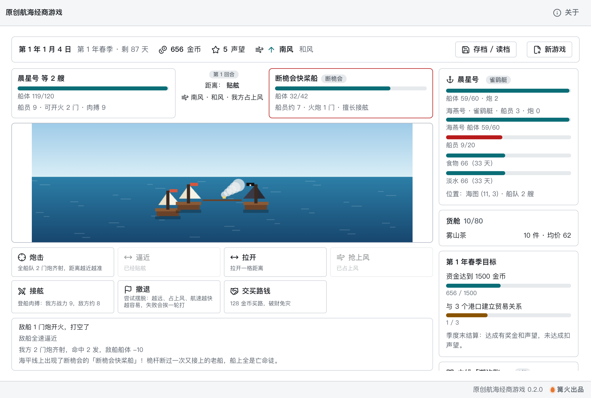

# 原创航海经商游戏

> 篝火出品 · 收录于篝火 App 应用区

原创世界的像素风航海经商游戏：驾船穿行虚构的「澜屿海」群岛，在 12 个港口之间买卖、补给、造船、招人，完成季度目标；遭遇海盗打一场回合制海战，带上最多 3 艘船的船队，追查一条 5 章的原创主线「潮汐账」。




## 原创声明

世界观（澜屿海、4 个文化区、12 个港口）、15 种商品、4 种船型、7 种敌船与势力、8 个海上事件、主线剧情、价格模型、数值与界面样式**全部为原创**，不基于、不模仿任何现有游戏。海图地形与美术由代码程序化生成，不使用任何外部图片、音频或数据表。

## 下载

到 [Releases](https://github.com/campfire-code/ocean-trade-voyage/releases/latest) 下载对应安装包：

| 电脑 | 文件 |
|---|---|
| Windows 10 / 11 | `ocean-trade-voyage_版本号_windows-x64-setup.exe` |
| Mac（Apple 芯片） | `ocean-trade-voyage_版本号_mac-arm64.dmg` |
| Mac（Intel 芯片） | `ocean-trade-voyage_版本号_mac-x64.dmg` |

第一次打开：
- **Windows**：如果弹出「Windows 已保护你的电脑」，点「更多信息」→「仍要运行」。
- **Mac**：如果提示「无法验证开发者」，打开「系统设置 → 隐私与安全性」，在下方点「仍要打开」。

## 怎么用

**开局**：从灰檐港出发，一艘雀鹞艇、800 金币、6 名船员。每个季度（90 天）有两个目标，右侧面板显示进度。

**航行**：点「起航」进入海图。点击海图水面自动航行；或用方向键（上下左右）、Q E Z C（四个斜向）手动操舵；空格停船。航行消耗天数与补给（食物、淡水，每 5 名船员每天各 1 份）；风向影响航速（顺风快、逆风慢，各船型逆风能力不同，右上角显示风向）；大风天可能损伤船体。补给耗尽会每天损失船员；船沉或人手不足时被渔船救起，送到最近港口，货物全损并付 15% 资金。驶到港口码头自动靠港。

**港口**
- 交易所：买卖 15 种商品。价格随库存涨跌，出产地便宜、缺货地贵，另有紧缺 / 过剩 / 庆典事件；买卖各有 5% 差价，一次买卖越多价格变化越大。
- 补给站：买食物、淡水。
- 船坞：修船，换乘 4 种船（雀鹞艇、双桅燕、宽肚鲸商、破浪鹰），旧船折价；大船需要声望，破浪鹰只有铜砂城能造。
- 酒馆：招募 / 遣散船员；请一轮酒（15 金币）打听哪里缺货、哪里压仓。
- 「休整一天」让行情恢复（工资照付）；工资每人每天 0.5 金币，靠港时结算，发不出会有人离队。

**目标与声望**：成交额累积声望；与某港口累计成交满 300 金币算建立贸易关系。季度末结算：达成目标有奖金和声望，未达成扣声望。

**海战（0.2.0 新增）**：航行满 12 天后，海上可能遇到海盗或敌对势力的船（离港越远、货越值钱越容易遇到，船上炮和护卫多则不敢来）。回合制，每回合选一个行动：
- 距离分 4 档（贴舷、近、中、远）。「炮击」距离越近越准；「逼近 / 拉开」比航速；「抢上风」占上风则命中更高、撤退更易；风力 3 级时炮击更不准。
- 「接舷」要先贴舷，比的是登船肉搏战力（船员 1，护卫 2.5）。赢了夺船、缴获金币和货物（有机会缴到火炮），输了被抢走 60% 货物、15% 金币，旗舰受伤，但不会直接出局。
- 「撤退」越远、占上风、航速越快越容易，失败要挨一轮。「交买路钱」只对海盗有效（敌对势力不收）。
- 敌船残破时会逃走，也算击退。船队全灭或人手不足时被渔船救走（与第一期相同，货物全损付 15% 救助费）。
- 前 12 天不会遇到敌船；前 90 天只会遇到最弱的「鬣鲨小艇」。身无分文、货舱空空时，港务官会借你 100 金币本钱（扣 1 点声望，20 天一次），避免卡死。

**装备与护卫**：船坞里买火炮（90 金币/门，每船有炮位上限；每 2 名船员才能操作 1 门）和加固铁皮（每级少挨 15% 炮击，最高 2 级）。酒馆里雇护卫（40 金币，每船最多 4 名，每天工资 1 金币，不占船员名额）。

**船队**：船坞里「加入船队」按原价买下僚船，最多 3 艘（旗舰加 2 艘），自动配齐最低船员。载货与补给合并计算，航速取最慢的一艘，海战时各船一起参战，炮击落在随机一艘船上。船沉或人手不足的僚船脱队，旗舰沉没则由僚船接任。

**随机事件与港口状态**：海上随机出现风暴漂流、遇难船、浮木货箱、大雾、无风带、路过的商船、鲸群、求救信号弹（可能是圈套）8 种事件，每次让你选怎么做。港口会出现庆典（奢侈品涨价）、封港（几天内不让进港）、瘟疫（粮价上涨、靠港染病掉船员），海图上用「庆 / 封 / 疫」标注，酒馆也会打听到。

**主线「潮汐账」**：5 章，右侧面板显示当前目标。第 1 章在累计成交 150 金币后，到灰檐港靠岸开启；之后每章到指定港口开启，靠送货、拜访、击退敌船、攒钱和驶到指定海面推进，完成有奖金和声望。

**存档**：右上角「存档 / 读档」有 5 个存档位，另有自动存档（下次打开自动接着玩）。存档只保存在本机的设置文件里，不上传。0.1.x 的存档会自动升级（旗舰补 2 门火炮，其余新内容从头开始）。

## 更新内容

### 0.2.0

- 新增回合制海战：距离、风向（上风）、炮击、接舷、撤退、买路钱，船型与船员数影响结果，战利品与败北损失。
- 新增 7 种原创敌船与 4 个势力；新增火炮与装甲装备、酒馆护卫。
- 新增最多 3 艘船的船队：载货补给合并，各船参战。
- 新增 8 种海上随机事件和港口庆典 / 封港 / 瘟疫，事件由数据表驱动。
- 新增 5 章主线「潮汐账」。
- 存档升级到第 2 版，0.1.x 的存档自动迁移。
- 新增破产救济，避免囊空如洗时卡死；修复自动航行在日志满 40 条后不再因新日志而停下的问题。
- 新增自动跑单的平衡模拟（测试里跑满一年）。

### 0.1.0

- 首个版本。

## 验收用例

本游戏不需要示例文件。以下用例都可以在界面上直接操作（自动化测试覆盖了对应的规则，`pnpm test`）：

| 操作 | 应得到的结果 |
|---|---|
| 新游戏后，在灰檐港交易所「风干鱼」点「买 10」 | 资金减少，货舱显示 10 件风干鱼与均价，港口库存减 10，买入价略升 |
| 起航，点海图上「雾灯镇」附近的陆地 | 船沿水路自动航行，日期推进，食物与淡水减少；到码头自动靠港并发工资 |
| 把风干鱼运到「椰影镇」全卖 | 椰影镇缺风干鱼，卖价明显高于灰檐港进价，利润为正 |
| 原地买入再立刻卖出同一商品 | 亏一点差价（买 5% 加价、卖 5% 折价） |
| 食物和淡水为 0 时继续航行 | 日志提示补给耗尽，船员逐天减少 |
| 船坞选「双桅燕」 | 声望不足时按钮灰掉并写明需要的声望；声望和资金够则换乘，旧船折价 |
| 存档位 1 存入，继续航行几天，再读取存档位 1 | 回到存档时的日期、位置、资金和货物 |
| 把本季度资金堆到 1500 金币 | 目标显示「✓」，季度末获得奖金与声望 |
| 关闭再打开应用 | 自动接着上次的航程 |
| 航行超过 12 天，持续在海上走（多跑几趟） | 遇到敌船时进入海战界面，不能再航行；战报显示每回合结果 |
| 海战中点「交买路钱」（对海盗） | 扣金币，战斗结束；对「敌对」标记的船该按钮灰掉并写明原因 |
| 海战中先「逼近」到贴舷再「接舷」 | 按双方战力出结果；赢了缴获金币和货物，输了丢 60% 货物与 15% 金币 |
| 船坞「加入船队」买一艘雀鹞艇 | 船队 2 艘，货舱、补给容量相加，右侧面板列出两艘船 |
| 船坞给旗舰买火炮到炮位满 | 按钮提示炮位已满；酒馆「雇满」护卫后每船最多 4 名 |
| 选海上事件「遇难船 → 救人」 | 耽搁 1 天，可能增加船员并得到谢礼 |
| 某港口被标「封」时驶到它的码头 | 提示封港、不能靠港，几天后再来可以进港 |
| 用 0.1.x 的存档读档 | 能读取，旗舰有 2 门火炮，主线显示第 1 章，其余进度不变 |
| 主线第 1 章：把 8 件帆麻布送到白鲸湾，再去雾灯镇 | 日志出现主线进展，章节完成发奖金与声望 |

## 已知限制

港口只有 12 个，海图是固定的一张；缴获的敌船不能收编进船队；海战里不能指定炮击哪艘船；主线通关后没有后续章节。

## 自己编译

需要 Node.js 22、pnpm、Rust。

```bash
pnpm install
pnpm test          # 单元测试
pnpm tauri dev     # 开发运行
pnpm tauri build   # 打包
```

界面框架在 `src/kit`（所有 campfire-code 工具共用），本工具的逻辑在 `src/tool`。

## 归属

本工具由**篝火**出品，是篝火 App 应用区收录的开源工具之一，由篝火（GitHub 组织 [campfire-code](https://github.com/campfire-code)）维护与更新。全部工具的目录见 [toolkit-hub](https://github.com/campfire-code/toolkit-hub)。

## 许可证

MIT，版权方为篝火（campfire-code）。
