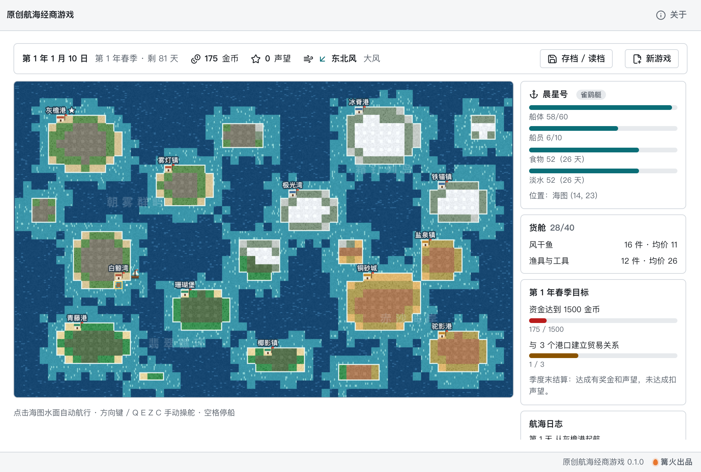

# 原创航海经商游戏

> 篝火出品 · 收录于篝火 App 应用区

原创世界的像素风航海经商游戏：驾船穿行虚构的「澜屿海」群岛，在 12 个港口之间买卖、补给、造船、招人，完成季度目标。




## 原创声明

世界观（澜屿海、4 个文化区、12 个港口）、15 种商品、4 种船型、价格模型、数值与界面样式**全部为原创**，不基于、不模仿任何现有游戏。海图地形与美术由代码程序化生成，不使用任何外部图片、音频或数据表。

## 下载

到 [Releases](https://github.com/campfire-code/ocean-trade-voyage/releases/latest) 下载对应安装包：

| 电脑 | 文件 |
|---|---|
| Windows 10 / 11 | `ocean-trade-voyage_版本号_windows-x64-setup.exe` |
| Mac（Apple 芯片） | `ocean-trade-voyage_版本号_mac-arm64.dmg` |
| Mac（Intel 芯片） | `ocean-trade-voyage_版本号_mac-x64.dmg` |

第一次打开：
- **Windows**：如果弹出「Windows 已保护你的电脑」，点「更多信息」→「仍要运行」。
- **Mac**：如果提示「无法验证开发者」，打开「系统设置 → 隐私与安全性」，在下方点「仍要打开」。

## 怎么用

**开局**：从灰檐港出发，一艘雀鹞艇、800 金币、6 名船员。每个季度（90 天）有两个目标，右侧面板显示进度。

**航行**：点「起航」进入海图。点击海图水面自动航行；或用方向键（上下左右）、Q E Z C（四个斜向）手动操舵；空格停船。航行消耗天数与补给（食物、淡水，每 5 名船员每天各 1 份）；风向影响航速（顺风快、逆风慢，各船型逆风能力不同，右上角显示风向）；大风天可能损伤船体。补给耗尽会每天损失船员；船沉或人手不足时被渔船救起，送到最近港口，货物全损并付 15% 资金。驶到港口码头自动靠港。

**港口**
- 交易所：买卖 15 种商品。价格随库存涨跌，出产地便宜、缺货地贵，另有紧缺 / 过剩 / 庆典事件；买卖各有 5% 差价，一次买卖越多价格变化越大。
- 补给站：买食物、淡水。
- 船坞：修船，换乘 4 种船（雀鹞艇、双桅燕、宽肚鲸商、破浪鹰），旧船折价；大船需要声望，破浪鹰只有铜砂城能造。
- 酒馆：招募 / 遣散船员；请一轮酒（15 金币）打听哪里缺货、哪里压仓。
- 「休整一天」让行情恢复（工资照付）；工资每人每天 0.5 金币，靠港时结算，发不出会有人离队。

**目标与声望**：成交额累积声望；与某港口累计成交满 300 金币算建立贸易关系。季度末结算：达成目标有奖金和声望，未达成扣声望。

**存档**：右上角「存档 / 读档」有 5 个存档位，另有自动存档（下次打开自动接着玩）。存档只保存在本机的设置文件里，不上传。

## 验收用例

本游戏不需要示例文件。以下用例都可以在界面上直接操作（自动化测试覆盖了对应的规则，`pnpm test`）：

| 操作 | 应得到的结果 |
|---|---|
| 新游戏后，在灰檐港交易所「风干鱼」点「买 10」 | 资金减少，货舱显示 10 件风干鱼与均价，港口库存减 10，买入价略升 |
| 起航，点海图上「雾灯镇」附近的陆地 | 船沿水路自动航行，日期推进，食物与淡水减少；到码头自动靠港并发工资 |
| 把风干鱼运到「椰影镇」全卖 | 椰影镇缺风干鱼，卖价明显高于灰檐港进价，利润为正 |
| 原地买入再立刻卖出同一商品 | 亏一点差价（买 5% 加价、卖 5% 折价） |
| 食物和淡水为 0 时继续航行 | 日志提示补给耗尽，船员逐天减少 |
| 船坞选「双桅燕」 | 声望不足时按钮灰掉并写明需要的声望；声望和资金够则换乘，旧船折价 |
| 存档位 1 存入，继续航行几天，再读取存档位 1 | 回到存档时的日期、位置、资金和货物 |
| 把本季度资金堆到 1500 金币 | 目标显示「✓」，季度末获得奖金与声望 |
| 关闭再打开应用 | 自动接着上次的航程 |

## 已知限制（第一期）

没有海战、随机剧情事件和多艘船队；港口只有 12 个；海图是固定的一张。

## 自己编译

需要 Node.js 22、pnpm、Rust。

```bash
pnpm install
pnpm test          # 单元测试
pnpm tauri dev     # 开发运行
pnpm tauri build   # 打包
```

界面框架在 `src/kit`（所有 campfire-code 工具共用），本工具的逻辑在 `src/tool`。

## 归属

本工具由**篝火**出品，是篝火 App 应用区收录的开源工具之一，由篝火（GitHub 组织 [campfire-code](https://github.com/campfire-code)）维护与更新。全部工具的目录见 [toolkit-hub](https://github.com/campfire-code/toolkit-hub)。

## 许可证

MIT，版权方为篝火（campfire-code）。
